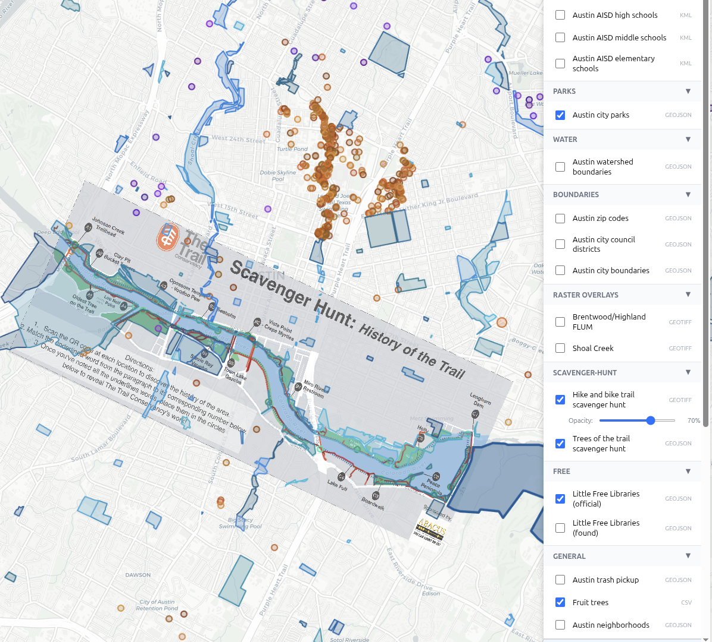

Overworld is a web app for viewing all conceivable types of 2D world map data (including georeferenced raster overlays).

It can display points, routes, regions, tileserver data, and static raster overlays.

It can show current user location, search for locations by address or business name, and do basic routing.

It supports a variety of base layers including [cyclOSM](https://www.cyclosm.org), and multiple geodata formats, with a preference for geojson.

It can render georeferenced tif files, which can easily be created at https://mapwarper.net/ (upload, rectify, export).

Data sources are defined with simple json files. There is no capability to upload or edit data within the app.



# Data files

Layer configs name data files by a logical path, `<region>/<file>` (e.g. `seattle/streets.geojson`). The files themselves can live in several *data roots*, so large files only need to exist on the machines that use them:

| root | holds | lives |
|---|---|---|
| `data/samples/` | a few small example files | committed |
| `data/sync/` | small and medium files, and your real layer configs | a synced folder, linked in |
| `data/local/` | large files (>100 MB) | one machine only, linked in |

Each machine has its own `config.json` (gitignored; start from `config.example.json`):

```json
{
  "roots": ["data/local/", "data/sync/", "data/samples/"],
  "layer_sets": ["layers/example.json", "data/sync/layers/seattle.json"],
  "hide_unavailable": false
}
```

- `roots` are searched in order. A root is available when its `_files.json` listing is reachable, so a root that isn't on this machine is simply skipped. A root can also be a URL, e.g. a web server holding the same `<region>/<file>` layout.
- `layer_sets` are the layer config files to load.
- Layers whose file isn't in any root are greyed out, or hidden with `hide_unavailable`.

With no `config.json` the app behaves as before: layer sets come from `layers/index.json` and files from `data/`.

Setting up a machine:

```sh
cp config.example.json config.json
tools/link-data.sh sync  ~/Sync/m2/web/overworld-data   # data/sync -> synced folder
tools/link-data.sh local /data/overworld                # large-file machine only
tools/index-data.py                                     # write each root's _files.json
python3 -m http.server                                  # serve; it follows the links
```

Rerun `tools/index-data.py` after adding, removing or moving data files. Moving a file between roots needs no config change.

# URL fragments

State is encoded in the URL fragment and updates live, so links can be shared to a specific view.

Parameters:
- `r` — comma-separated region keys to expand (`austin`, `seattle`, `texas`, `usa`). Omitted when all regions are expanded (the default).
- `l` — comma-separated layer IDs to enable. Layer IDs are the lowercased, hyphenated layer names.

Examples:

```
# Open with only the Seattle section expanded, centered on Seattle
#r=seattle

# Open with Austin and Texas sections expanded
#r=austin,texas

# Open with two layers enabled
#l=austin-zip-codes,austin-city-council-districts

# Open centered on Seattle with a specific layer enabled
#r=seattle&l=seattle-link-rail-stations
```

# Alternatives
- google earth
- qgis
- https://github.com/qgis/qwc2-demo-app
- https://github.com/NASA-AMMOS/MMGIS
- https://www.offline-maps.net/

- https://docs.mapstore.geosolutionsgroup.com/en/latest/ - not sure if it supports general uploads
- https://terria.io/plans - expensive
- arcgis - expensive
- https://felt.com/ - no free export or import ($200/month)
- https://sepal.io/ - more focused on professional remote sensing?
- https://geonode.org/ - awaiting account approval
- https://mapcarta.com/ - don't see a data upload option?

https://old.reddit.com/r/gis/comments/zo7ee9/open_source_alternatives_to_arcgis_online/
